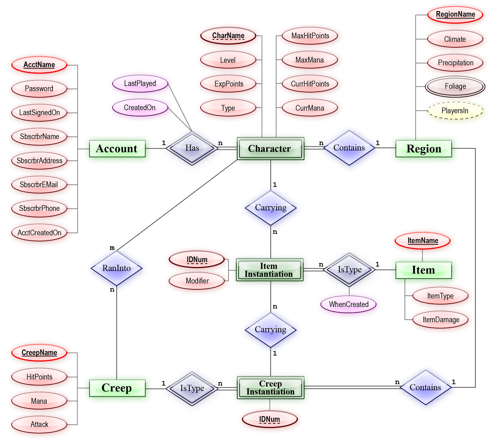

# Database

### 데이터와 정보
- 데이터(Data): 아직 가공되지 않은 개별적인 사실이나 값. 문맥이 없어 그 자체로는 의미를 갖기 어려움
	- user01, 티셔츠, 25000 같은 값만 봐서는 누가 무엇을 샀는지, 25000이 가격인지 재고인지 알 수 없음
- 구조화된 데이터(Structured Data): 각 값에 주문번호, 고객ID, 상품명 같은 꼬리표(Label)를 붙여 표 형태로 정리한 데이터
	- 의미는 생겼지만, "어떤 상품이 가장 많이 팔렸는가?" 같은 질문에 바로 답해주지는 못함
- 정보(Information): 구조화된 데이터를 특정한 질문이나 목적을 가지고 필터링, 그룹화, 집계하여 얻어낸 유의미한 결과물
	- 정보가 있어야 재고 관리, 마케팅, 프로모션 기획 같은 의사결정을 내릴 수 있음
- 데이터베이스는 데이터를 체계적으로 저장하고, 원하는 조건으로 빠르게 찾아 가공하여 정보로 만들 수 있도록 도와주는 도구임

<br>

### 데이터베이스(DB, Database)
- 다수의 사용자에 의해 쓰여지는 데이터의 집합을 의미함
- 서로 연관성있는 데이터들의 집합이기 때문에, 체계를 가지고 관리가 이루어짐
- 데이터베이스 주요 특징
	- 실시간 접근성(real-time accessibility): 사용자의 질의에 즉각적인 처리와 응답이 가능함
	- 계속적인 변화(continuous evolution): 상황에 맞춰 데이터의 추가/삭제/수정을 통해 항상 최신의 데이터를 유지함
	- 동시 공유(concurrent sharing): 여러 애플리케이션에서 사용하기 때문에, 다수의 사용자가 동시에 같은 내용의 데이터를 공유할 수 있음
	- 내용에 의한 참조(content reference): 데이터 참조 시 데이터 레코드의 주소나 위치로 찾지 않고, 데이터 내용으로 데이터를 찾음

<br>

### 파일 시스템으로 데이터를 관리할 때의 문제점
- 텍스트 파일이나 엑셀로도 데이터를 관리할 수 있지만, 규모가 커지고 여러 사람이 함께 사용하면 다음과 같은 문제가 드러남
	- 데이터 중복과 불일치: 같은 고객 주소를 여러 파일에 복사해두면, 한 곳만 수정되었을 때 값이 서로 어긋남
	- 데이터 접근의 어려움: 여러 파일에 흩어진 데이터를 조합하여 원하는 조건으로 찾으려면, 요청이 올 때마다 직접 뒤지거나 새로 코드를 짜야 함
	- 무결성 제약조건 적용의 어려움: 가격은 0보다 커야 한다, 아이디는 중복될 수 없다 같은 규칙을 파일 자체가 강제하지 못함
	- 동시성 제어 문제: 재고가 1개 남은 상품을 두 사람이 동시에 확인하고 판매하면, 둘 다 주문이 완료되는 상황이 생김
	- 보안 문제: 파일 단위의 권한만 줄 수 있어서, 특정 사람에게 특정 컬럼만 보여주는 식의 세밀한 제어가 어려움
	- 복구와 백업의 어려움: 장애 직전의 최신 상태로, 그리고 데이터 간 일관성을 지키면서 복구하기가 매우 어려움
- 이러한 문제를 해결하기 위해 DBMS가 등장함

<br>

### DBMS(Database Management System)
- 데이터베이스 관리 주체
- 사용자와 데이터베이스 사이에서 데이터베이스를 생성, 정의, 공유, 사용, 관리하는 기능을 수행하는 소프트웨어 시스템
- 프로그램을 이용하는 사용자는 프로그램이 참조하는 DB에 저장된 데이터를 쉽게 찾고 효율적으로 추가/삭제/수정할 수 있어야 함
- 일상에서 쓰이는 데이터들이 모인 DB 자체로는 할 수 있는게 없기 때문에, 이를 관리하는 주체가 필요함
- 시스템 구축 시, 용도에 맞는 DBMS를 적재적소에 맞춰 구성해야 함
- DBMS도 결국 운영체제의 파일 시스템 위에 자신만의 형식으로 된 파일에 데이터를 저장함
	- 사용자는 내부 파일 구조를 알 필요 없이 SQL 같은 표준화된 언어로 요청만 하면 되며, 이를 추상화라고 함
	- DBMS가 관리하는 내부 파일을 직접 열어서 수정하면 데이터가 손상될 수 있으므로, 모든 접근은 반드시 DBMS를 통해야 함
	- 은행 창구(SQL)를 통해 입출금만 요청하면, 돈을 어느 금고에 어떻게 보관할지는 은행(DBMS)이 알아서 처리하는 것과 같음
- DBMS 필수 기능
	- 정의(Definition)
		- 다양한 형태의 데이터 요구를 지원할 수 있도록 가장 적절한 데이터베이스 구조를 정의할 수 있어야 함
	- 조작(Manipulation)
		- 사용자와 데이터베이스 사이의 인터페이스를 위한 수단을 제공해야 함
		- 사용자의 요구에 따라 데이터베이스를 체계적으로 접근하고 조작 가능해야 함
	- 제어(Control)
		- 적절한 권한 조정을 통해 데이터베이스에 있는 데이터의 정확성과 보안성을 유지해야 함
- 파일 시스템의 문제를 해결하는 주요 기능
	- 보안: 허가된 사용자만 접근하도록 하고, 사용자별로 접근 가능한 데이터와 작업을 제한함
	- 동시성 제어(Concurrency Control): 여러 사용자가 같은 데이터를 동시에 수정할 때 잠금(Lock) 등으로 순서를 제어함
	- 트랜잭션 관리(Transaction Management): 여러 작업을 하나의 논리적 단위로 묶어서, 모두 성공하면 확정(Commit)하고 하나라도 실패하면 모두 되돌림(Rollback)
		- 계좌 이체처럼 출금과 입금이 반드시 함께 성공하거나 함께 실패해야 하는 작업에 필수적임
	- 중복 최소화: 정규화를 통해 데이터를 여러 테이블로 나누어 저장하고, 다른 테이블에서는 ID만 참조하도록 함
	- 백업과 복구: 변경 사항을 로그로 기록해두고, 장애가 발생하면 특정 시점으로 복원할 수 있도록 함
- 실무에서는 데이터베이스와 DBMS를 엄밀하게 구분하지 않고, 둘을 합쳐 DB라고 부르는 경우가 많음

<br>

### RDBMS(Relational Database Management System)
- 관계형 데이터베이스를 관리하기 위한 시스템
- 데이터가 2차원 테이블(Table) 형태로 저장되며, 테이블 간의 관계를 통해 데이터를 연결하고 관리함
- 워낙 많이 사용되기 때문에 보통 RDB라고 줄여 부르며, 그냥 DB라고 하면 RDBMS를 뜻하는 경우가 많음
- RDBMS가 기본이 되는 이유
	- 데이터 타입과 제약조건으로 데이터의 무결성을 강하게 보장함
	- 트랜잭션의 ACID(원자성, 일관성, 고립성, 지속성)를 지원하여 주문, 결제 같은 처리에 신뢰성이 높음
	- SQL이라는 표준 질의어를 사용함
	- 수십 년간 발전해 온 기술이라 안정적이고, 문서와 도구 등의 생태계가 풍부함
- 대표적인 RDBMS
	- Oracle: 기능과 안정성이 최고 수준인 상용 RDBMS. 대기업, 금융권, 공공기관에서 많이 사용하지만 라이선스 비용이 매우 비쌈
	- MySQL: 가장 널리 사용되는 오픈 소스 RDBMS 중 하나. 웹 서비스와 스타트업에서 압도적으로 많이 사용함
	- MariaDB: MySQL이 오라클에 인수된 후 MySQL의 창립 멤버들이 만든 RDBMS. MySQL과 거의 대부분 호환됨
	- PostgreSQL: 표준 SQL 준수, 복잡한 쿼리 처리, 확장 기능이 뛰어난 오픈 소스 RDBMS. 최근 사용이 꾸준히 늘고 있음
	- Microsoft SQL Server: Windows 서버와 .NET 기반 환경에서 주로 사용함
	- H2, SQLite: 별도의 서버 없이 애플리케이션에 포함되어 실행되는 임베디드 DB. 테스트나 모바일 앱 내부 저장소로 사용함
- 대부분의 RDBMS는 ANSI/ISO SQL 표준을 따르므로, 하나를 제대로 익히면 다른 RDBMS에도 쉽게 적응할 수 있음

<br>

### NoSQL(Not Only SQL)
- 관계형 모델을 사용하지 않거나, SQL을 주요 접근 언어로 사용하지 않는 DBMS를 통칭함
- 대량의 비정형 데이터, 매우 빠른 읽기/쓰기, 유연한 데이터 모델 같은 특정 요구사항을 만족시키기 위해 등장함
- 대표적인 분류
	- 키-값 저장소: 키와 값 한 쌍으로 저장하며, 단건 읽기/쓰기가 매우 빠름. 세션, 캐시 등에 사용함(Redis, Memcached)
	- 문서 DB: JSON/BSON 형태의 문서로 저장하며, 스키마가 유연함. 상품 카탈로그 등에 사용함(MongoDB, Couchbase)
	- 컬럼 패밀리 저장소: 컬럼 그룹 단위로 저장하며, 대용량 분산 처리에 유리함. 로그, 시계열 데이터 등에 사용함(Cassandra, HBase)
	- 그래프 DB: 노드와 엣지로 저장하며, 복잡한 관계 탐색에 유리함. 추천, 이상 탐지 등에 사용함(Neo4j)
- NoSQL은 RDBMS를 대체한다기보다 상호 보완적인 관계로 보는 것이 좋음
	- 서비스 초기에는 RDB만 사용하다가, 서비스가 커져서 꼭 필요한 상황이 생기면 그때 부분적으로 도입하는 것이 좋음
	- 새로운 저장소를 도입할 때마다 관리해야 하는 시스템이 늘어난다는 점을 신중하게 고려해야 함

<br>

### PostgreSQL
- 객체-관계형 DBMS(ORDBMS)로써, 순수 RDBMS인 MariaDB와는 다르게 데이터를 하나의 객체로 저장할 수 있음. 따라서, 테이블 상속을 지원함
- 인프라 구성이 MySQL에 비해 다소 까다롭고 진입장벽이 높은 편이나, 복잡한 쿼리를 사용했을 때 발휘되는 성능상의 이점으로 인해 점유율이 꾸준하게 높아지는 추세
- 전반적인 CRUD 성능이 MariaDB에 비해 다소 느린 편. UPDATE문 수행 시 MariaDB와는 다르게 DELETE -> INSERT 과정을 거쳐서 진행
- 간단한 쿼리가 주로 필요한 경우 MariaDB를 사용하며, 복잡한 쿼리가 많고 INSERT 쿼리가 많은 경우 PostgreSQL을 사용하는게 좋음

<br>

### 데이터베이스 언어
- 데이터 정의 언어(DDL, Data Definition Language): 데이터베이스 명세라 할 수 있는 스키마를 정의할 때 사용하는 언어
	- CREATE: 데이터베이스, 테이블 생성
	- ALTER: 테이블 수정
	- DROP: 데이터베이스, 테이블 삭제
	- TRUNCATE: 테이블 초기화
- 데이터 조작 언어(DML, Data Manipulation Language): 데이터베이스에 데이터를 추가하거나 저장된 데이터를 조회/수정/삭제할 때 사용하는 언어
	- SELECT: 데이터 조회
	- INSERT: 데이터 삽입
	- UPDATE: 데이터 수정
	- DELETE: 데이터 삭제
- 데이터 제어 언어(DCL, Data Control Language): 데이터베이스 접근 권한을 조정할 때 사용하는 언어
	- GRANT: 특정 작업에 대한 수행 권한 부여
	- REVOKE: 특정 작업에 대한 수행 권한 회수
- 트랜잭션 제어 언어(TCL, Transaction Control Language): DML로 수행한 변경 작업들을 하나의 트랜잭션 단위로 묶어서 관리하는 언어
	- COMMIT: 트랜잭션 작업 저장
	- ROLLBACK: 트랜잭션 작업 취소 후 원상복구

<br>

### SQL(Structured Query Language)
- DBMS에 저장된 데이터를 관리하기 위한 질의언어
- ISO/ANSI에서 표준을 정한 관계형 데이터베이스의 표준 언어
	- 각 DBMS가 표준 외에 추가로 제공하는 고유한 기능과 문법을 방언(Dialect)이라고 함
	- CREATE, SELECT, INSERT 같은 핵심 문법은 거의 같으므로, 한 번 익혀두면 다른 RDBMS에서도 그대로 활용할 수 있음
- 선언적 언어(Declarative Language)
	- 데이터를 '어떻게(How)' 가져올지가 아니라 '무엇을(What)' 원하는지만 명시함
	- 가장 효율적인 처리 방법은 DBMS가 스스로 찾아서 수행함

<br>

### 데이터 모델(Data Model)
- 현실 세계에 있는 데이터를 데이터베이스 내부의 데이터로 옮기는 과정. 관점에 따라 아래와 같이 세 가지로 구분함
	- 개념적(Conceptual) 데이터 모델
	- 논리적(Logical) 데이터 모델
	- 물리적(Physical) 데이터 모델
- 관계형 데이터 모델
	- 데이터를 2차원 테이블(Table) 형태로 구성하는 작업
	- 속성(Attribute): 이름과 타입으로 구성된 값. 테이블 내에서 유일한 값을 가짐
	- 튜플(Tuple): 속성과 값으로 이루어진 쌍의 집합. 하나의 Row 혹은 Record로 간주함
	- 관계(Relation): 튜플의 집합으로써, 하나의 Table로 간주함
- 실무에서는 테이블(Table), 행(Row), 열(Column)이라는 용어를 주로 사용함
	- 행은 레코드(Record) 또는 튜플(Tuple), 열은 필드(Field) 또는 속성(Attribute)이라고도 부름

<br>

### 기본 키(Primary Key)와 외래 키(Foreign Key)
- 기본 키(PK): 테이블의 모든 행 중에서 특정 행 하나를 유일하게 식별할 수 있는 열 또는 열들의 조합
	- 고유성(Uniqueness): 같은 테이블 안에서 값이 절대 중복될 수 없음
	- NOT NULL: 반드시 값이 있어야 함
	- 이름, 주소, 상품명까지 모두 같은 주문이 두 건 있어도, 주문번호(PK)가 있으면 어떤 주문인지 정확히 구분할 수 있음
	- 모든 테이블에는 기본 키를 두는 것이 원칙이며, 실무에서는 1씩 자동으로 증가하는 정수를 테이블명_id 형식의 이름으로 사용하는 경우가 가장 흔함
- 외래 키(FK): 한 테이블의 열이 다른 테이블의 기본 키 값을 참조하는 것
	- 고객 정보를 고객 테이블에 한 번만 저장하고 주문 테이블에는 customer_id만 두면, 주소가 바뀌어도 한 곳만 수정하면 됨
	- 외래 키를 가진 쪽(주문)이 자식 테이블, 참조되는 쪽(고객)이 부모 테이블이 됨
	- 참조 무결성(Referential Integrity): 외래 키 값은 반드시 부모 테이블의 기본 키 값 중 하나이거나 NULL이어야 함
		- 존재하지 않는 고객의 ID로 주문을 넣으려고 하면 DBMS가 오류를 발생시켜 막아줌
- 테이블, 기본 키, 외래 키가 관계형 데이터베이스의 가장 핵심적인 개념이며, 이를 통해 작고 관리하기 쉬운 여러 테이블로 전체 데이터를 구조화할 수 있음

<br>

### 관계대수(Relational Algebra)
- 기존의 릴레이션으로부터 특정 연산을 거쳐 새로운 릴레이션을 나타내는 과정
- 하나의 릴레이션을 가지고 수행하는 단항연산과 두 개 이상의 릴레이션을 가지고 수행하는 이항연산이 있음
	- 단항연산: Selection, Projection, Rename 등등
	- 이항연산: Cartesian Product, Set Union, Set Difference 등등
- 자주 사용하는 연산
	- Selection
		- 특정 조건을 만족하는 튜플만 골라서 새로운 릴레이션을 구성함. SQL에서 WHERE절을 이용하여 표현가능
	- Projection
		- 임의의 릴레이션이 가지고 있는 속성 중 원하는 속성만 골라서 새로운 릴레이션을 구성함. SQL에서 SELECT절에 컬럼을 나열하여 표현가능
	- Cartesian Product
		- 두 릴레이션에 해당하는 모든 튜플들을 조건없이 합쳐서 새로운 튜플로 구성함. SQL에서 FROM절 뒤에 테이블 이름을 그대로 나열하면 됨
	- Join
		- 두 릴레이션에 대해 특정 조건을 만족하는 데이터를 가지고 새로운 튜플을 구성함. SQL에서 JOIN 키워드를 이용하여 표현가능
		- 실무에서는 Cartesian Product을 직접 사용하는 경우는 거의 없으며, 주로 아래와 같이 Left Outer Join을 많이 사용함

```
SELECT a1, a2
FROM r1, r2
WHERE a1=a

SELECT r1.a1 AS r1_a1, r2.a3
FROM r1
LEFT OUTER JOIN r2 ON r1.a1 = r2.a2;
```

<br>

### 개체-관계 모델(Entity-Relationship Model)
- 데이터들을 여러 개의 개체(Entity)들로 분류한 후, 각각의 개체에 따른 관계(Relationship)를 구성하여 기술한 모델
- 가장 인기있는 개념적 데이터 모델이라 할 수 있음
- 아래와 같이 하나의 Diagram(ERD, ER Diagram)으로 표현할 수 있음. 말이 되는 표현이 되게끔 설계가 이루어져야 함
	- 개체는 사각형으로 표현하며, 개체에 있는 속성(Attribute)들은 원으로 표현함. 그리고 개체를 이어주는 관계는 마름모로 표현함

<figure></figure>

<br>

### 데이터베이스 정규화(Normalization)
- 데이터베이스 설계 시, 중복을 최소화하여 무결성을 보장하기 위해 수행되는 일련의 과정
- 제1정규형(1NF), 제2정규형(2NF), 제3정규형(3NF), 보이스/코드 정규형(BCNF) 등등이 있음
	- 제4정규형(4NF), 제5정규형(5NF)도 있으나, 실무에서는 주로 3NF, BCNF까지만 수행함
- 제1정규형(1NF): 모든 릴레이션에 있는 속성값들이 하나의 원자값으로 이루어져야 함
- 제2정규형(2NF): 1NF에서 모든 속성값들이 기본키(PK)에 대해 완전 함수 종속을 만족해야 함. 즉, 기본키가 아닌 속성이 기본키에 부분적으로 종속되지 않아야 함
- 제3정규형(3NF): 2NF에서 기본키가 아닌 속성이 다른 속성들을 결정하는 이행적 함수 종속이 없어야 함
- BCNF: 임의의 릴레이션에서 결정자이면서 후보키가 아닌 컬럼이 존재하지 않아야 함

<br>

### 성능 문제를 해결하는 순서
- 실무에서 발생하는 장애의 상당수는 데이터베이스를 잘못 다루어서 발생함
- 대용량 트래픽 문제를 해결할 때는 외부 캐시부터 도입하기보다, 데이터베이스를 먼저 제대로 활용하는 것이 우선임
	1. 조인, 서브쿼리 등 DB 기본기를 제대로 익히기
	2. 인덱스 등을 활용하여 DB의 성능을 최대한 끌어내기
	3. 메인(Primary) DB와 읽기 전용 복제(Replica) DB를 분리하기
	4. 마지막으로 Redis 같은 외부 캐시 도입을 고려하기

<br>

#### 참고
- 인프런 <김영한의 실전 데이터베이스 입문 - SQL부터 차근차근> - 김영한
- https://terms.tta.or.kr/dictionary/dictionaryView.do?subject=%EB%8D%B0%EC%9D%B4%ED%84%B0%EB%B2%A0%EC%9D%B4%EC%8A%A4
- https://en.wikipedia.org/wiki/Entity%E2%80%93relationship_model
- https://aws.amazon.com/ko/compare/the-difference-between-mysql-vs-postgresql/

#### 배워가는 것들
- 백엔드 모듈에서 사용하는 영속성 데이터를 저장 및 관리하기 위한 기본 원리에 대해 탐구할 수 있었다.
	- 데이터베이스에 대한 개념과 주요 특징에 대해 익힐 수 있었다.
	- DBMS에 대한 중요 개념을 하나하나 익힐 수 있었다.
	- 데이터 모델, 관계대수에 대한 중요 개념을 익힐 수 있었다.
- 최근들어 각광받는 PostgreSQL에 대한 주요 특징을 익힐 수 있었다. MySQL 혹은 MariaDB뿐만 아니라, PostgreSQL에 대해서도 친숙해질 수 있도록 잘 익혀나가야 할 것이다.
- 프로그램 설계 단계에서 ER Model을 잘 활용할 수 있도록 한다. "말이 되는 설계"가 될 수 있도록 꾸준히 단련시켜야 할 것이다.
- 데이터베이스 정규화에 대한 특징을 개략적으로 정리할 수 있었다.
- 데이터를 정보로 만드는 과정을 통해, 데이터베이스가 단순한 저장소가 아니라 의사결정을 돕는 도구라는 점을 다시 생각해볼 수 있었다.
- 파일 시스템의 한계를 하나씩 짚어보니, DBMS가 제공하는 무결성, 동시성 제어, 트랜잭션, 복구 기능이 왜 필요한지 더 분명하게 이해할 수 있었다.
- NoSQL은 RDB를 대체하는 것이 아니라 보완하는 것이며, 저장소를 하나 늘릴 때마다 관리 포인트도 함께 늘어난다는 점을 기억해야겠다.
